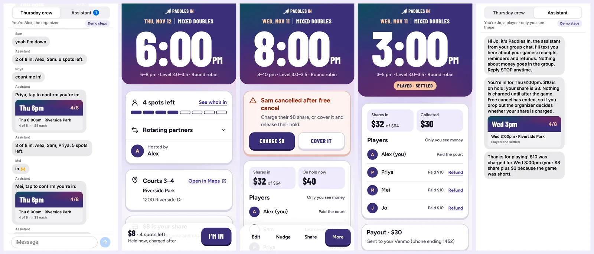
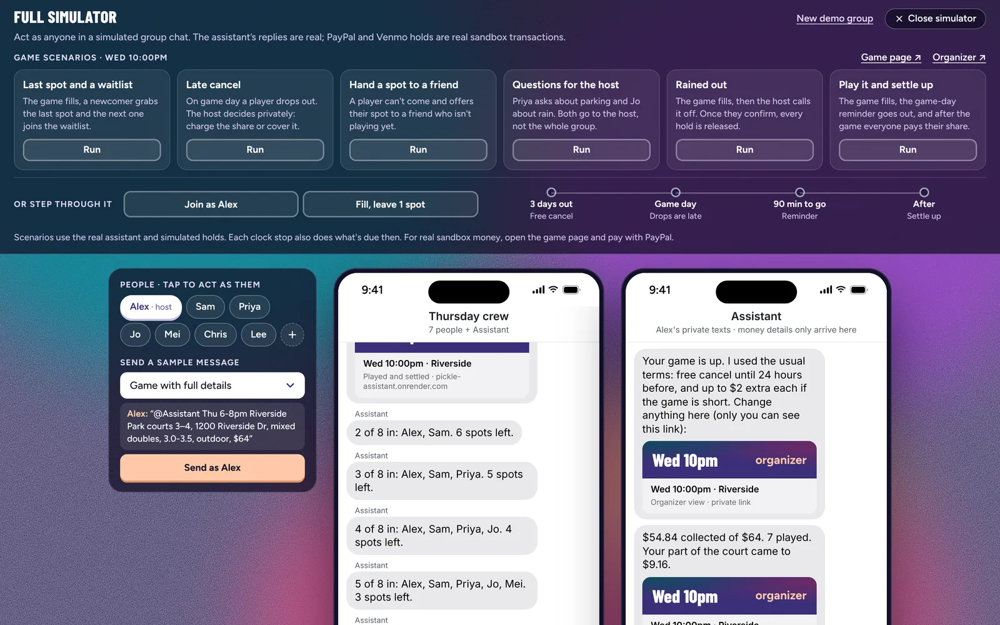

# Paddles In

**An AI assistant that lives in your pickleball group chat. Friends say they're in and hold their spot with PayPal or Venmo. After the game each player is charged their real share, and the organizer is paid back. Nobody chases anyone.**

Entry for the PayPal AI Hackathon 2026. Runs in the PayPal sandbox. MIT licence.

<!-- Before submission: replace VIDEO_URL with the public YouTube link. -->
**[▶ Demo video (under 3 min)](VIDEO_URL)** · **[Try it on your phone](https://pickle-assistant.onrender.com/demo)** · **[Live site](https://pickle-assistant.onrender.com)** · **[For judges](JUDGES.md)** · **[Every PayPal call](docs/PAYPAL.md)** · **[Proof from a real run](#proof-from-a-real-sandbox-run)**


## In 30 seconds

| | |
|---|---|
| **Who it's for** | The person in every rec pickleball group who books the court, pays for it, and then chases eight friends for $8 each |
| **What changes** | Players commit with a PayPal or Venmo **hold**, not a promise. No-shows and late drops are settled by rules everyone saw up front |
| **PayPal** | Orders v2 `AUTHORIZE`, partial capture, void, reauthorize, refund, Payouts to Venmo, verified webhooks, `PayPal-Request-Id` on every write |
| **AI** | Claude Haiku 5.5 reads every group message with forced tool calls: sets up the game, understands "yeah I'm down", "can Lee take my spot?", "is there parking?" |
| **The line it never crosses** | Claude decides what people *mean*. Deterministic code decides every amount and every PayPal call |
| **Try it with no keys** | [`/play`](https://pickle-assistant.onrender.com/play): a private group chat with seven friends and one-tap game scenarios |



## For judges and AI reviewers

Everything a reviewer needs is one link away:

- [JUDGES.md](JUDGES.md): each judging criterion mapped to the code that backs it, plus known limits.
- [docs/PAYPAL.md](docs/PAYPAL.md): every PayPal call, the moment that triggers it, its idempotency key and the file it lives in.
- [Proof from a real sandbox run](#proof-from-a-real-sandbox-run): real PayPal ids from one complete game.
- Where to read the code: money rules in `src/bot/assistant.ts`, PayPal client in `src/lib/paypal.ts`, Claude in `src/bot/agent.ts` and `src/bot/parse.ts`, scheduled jobs in `src/workflows/tasks.ts`.
- Checks: `pnpm typecheck`, `pnpm lint`, `pnpm test` (unit tests for money maths, the rule fallback, limits and retries) and `pnpm build` run in CI on every PR.

## The problem

Rec pickleball is organized in group chats. One person books the court and pays for it, then chases everyone for their share. People say "maybe", drop out late or never pay, and asking for money in the group is awkward.

## Why it's different

- **It lives where the group already talks.** Players need no app and no account with us. The assistant stays quiet during small talk, answers game questions, and sends anything about money privately.
- **A hold as a commitment device.** "I'm in" means a PayPal or Venmo authorization, so a spot is real. Free cancel releases it; a late drop is the organizer's call.
- **Charged for what the game really cost.** Each hold is the share plus a small agreed cap. After the game PayPal captures only the real share (a partial capture) and releases the rest.
- **The organizer gets paid back, not just the app.** One PayPal Payout sends what was collected to the organizer's Venmo or PayPal.
- **It recovers by itself.** Holds are renewed before they expire, and a settle cut off by a restart is finished by the next scheduled run on Render Workflows.

## What it does

1. **The organizer texts the group:** `@Assistant Thu 6pm Riverside courts 3–4, $64`. Claude turns it into a game (8 spots, $8 each, free cancel until the day before) and posts a link. If details are missing, it starts a draft and asks the organizer privately.
2. **Players hold their spot:** "yeah I'm down" gets them the link; tapping **I'm in** places a PayPal authorization (Orders v2, intent AUTHORIZE) for their share plus a small cap. Nothing is charged.
3. **It handles the messy middle:** free-form replies (out, maybe, waitlist, "can Lee take my spot?", "is there parking?"), late cancels (organizer charges or covers), invite-only games and reminders.
4. **It settles after the game:** each player is captured for their real share; the rest of each hold is released. If the game ran short, the organizer chooses to split the gap (never past the cap players agreed to) or cover it. Money details only ever go to people privately.
5. **It pays the organizer back:** what was collected goes to the organizer's Venmo (phone or @handle) or PayPal email in one PayPal Payout, with a private note when it lands.
6. **It fixes mistakes:** a charged player can tap "I did show up"; the organizer refunds through PayPal in one tap. If the game is called off after free cancel and the court fee is lost, the organizer can charge each player their share instead of releasing everyone.

## How PayPal and AI are used

| | What | Where |
|---|---|---|
| PayPal | Orders v2 intent AUTHORIZE, authorize, capture (partial), void, reauthorize, refund; Payouts to Venmo or PayPal; verified webhooks; idempotent PayPal-Request-Id on every write; PayPal JS SDK buttons with PayPal and Venmo funding | `src/lib/paypal.ts`, `src/bot/payout.ts`, `src/lib/webhooks.ts`, `src/app/api/paypal/`, `src/bot/assistant.ts`. Full map: [docs/PAYPAL.md](docs/PAYPAL.md) |
| AI | Claude Haiku 5.5 (Anthropic) with forced tool calls: `create_game` parses a setup message; `decide` interprets every other group message. A rules-based fallback runs if Claude is unavailable | `src/bot/parse.ts`, `src/bot/agent.ts` |
| Boundary | The model only decides what people mean. Every money movement is deterministic code with fixed rules | `src/bot/assistant.ts` |
| Scheduling | Render Workflows: reminders, auto-settle, hold renewal, payout retries, recovery after a restart | `src/workflows/tasks.ts`, `render.workflows.yaml` |

## Proof from a real sandbox run

<!-- Before submission: paste the output of `pnpm proof` here, replacing this comment and the line below. -->
_The table of real sandbox ids from the final run goes here._

To make this table from your own run: play a game with a PayPal sandbox buyer, then run `pnpm proof` (or `pnpm proof <game-slug>`) with `DATABASE_URL` set. It reads the database only and lists real sandbox ids, never simulated ones.

## What's real in the demo

The phone demo and `/play` simulator use a simulated group chat, so anyone can try it without a phone number. Real texting works through iMessage (Blooio) and SMS (Sendblue) when those keys are set; see below. **Real:** Claude reading every message, the game pages, and any hold you place through the PayPal sandbox, which is authorized, captured or voided against PayPal's API. **Simulated:** the other players and their holds (authorization ids starting with `SIM-`), so a game can fill in seconds.


## Run it locally

Requires Node 22+ and pnpm (`corepack enable`).

```bash
cp .env.example .env      # then fill in your PayPal sandbox keys
pnpm install
pnpm dev                  # http://localhost:3000/play
```

You need a Postgres database (`DATABASE_URL`); tables are created automatically on first request.

Approve the hold with a PayPal sandbox personal account (developer.paypal.com > Sandbox Accounts).

To receive PayPal webhooks while developing, expose your machine with a quick tunnel:

```bash
cloudflared tunnel --url http://localhost:3000
```

## How it works (v1)

- **/demo** pairs your phone: you run the game as organizer while the page plays the group (friends join, you switch to a player and pay, someone cancels late, the game settles).
- **/play** gives you a private sample group chat with seven friends. Switch who you're typing as.
- As Alex, post `@Assistant Thu 6pm Riverside courts 3–4, 8 spots, $64`. The game is posted right away with default terms; Alex gets a private organizer link.
- Anyone who says "in" gets the game link. On the game page, "I'm in" and the PayPal or Venmo hold are one step. Holds cover the share plus a small cap for short games.
- "out" (or "Can't make it" on the page) releases the hold before the free-cancel time; after it, the organizer decides to charge or cover.
- The organizer page shows money progress, players (amounts visible only to the organizer), activity, terms editing, a nudge, and settle or cancel.
- Money details are only sent privately (the playground's inbox), never to the group.

`src/bot/assistant.ts` holds the chat behavior and doesn't depend on the chat channel, so real channels (iMessage through Blooio, via Chat SDK) call the same functions.

### Real iMessage (Blooio)

With `BLOOIO_API_KEY` set, the assistant also runs in real iMessage groups through [Blooio](https://blooio.com) and the Chat SDK adapter (`src/bot/imessage.ts`):

1. In Blooio, add a webhook to `https://<your-app>/api/blooio/webhook` and put its signing secret in `BLOOIO_WEBHOOK_SECRET`.
2. Add the Blooio number to an iMessage group. The first text in the group creates the group and each sender here; a sender's name comes from Blooio's contact name, otherwise their number.
3. Group posts go to the group. Private messages go to each person's own 1:1 thread, and only to people who opted in. Texting the Blooio number directly opts you in.

Blooio limits how many conversations the bot can start each day, so people opting in by texting first is the cheapest path.

### The phone demo by real text (Sendblue free sandbox)

With `SENDBLUE_API_KEY`, `SENDBLUE_API_SECRET` and `SENDBLUE_FROM_NUMBER` set, `/demo` offers "Or use your own Messages app":

1. The judge types their first name and mobile number. The app adds the number to the Sendblue contacts (the free plan only texts contacts, and allows 10).
2. The page shows a code. Texting `JOIN 1234` to the Sendblue number links that phone to the demo and completes Sendblue's check.
3. Their texts go into the demo's group chat as them (the organizer, or Jo after "Switch my phone to a player"). The assistant's group posts (marked `[Group]`) and their private messages come back as texts, with game links that open as them. The rest of the group stays simulated on the desktop.

The sandbox has no webhooks, so the server checks Sendblue for new texts every 4 seconds (`src/bot/sendblue.ts`, started in `src/instrumentation.ts`). Replies take a few seconds, and the web service must be awake.

## Scheduled work (Render Workflows)

`src/workflows/tasks.ts` defines Render Workflow tasks with the Render SDK. A cron job (`pnpm trigger`) starts the `tick` task every 10 minutes; `tick` finds what's due and fans out one task run per item:

- `sendCancelByReminder`: one reminder in the group, in the 3 hours before free cancel ends, to people who said "in" but haven't confirmed
- `sendGameDayReminder`: "Game in 2 hours" in the group
- `settleGame`: settles a game 3 hours after it starts if the organizer hasn't
- `reauthorizeHold`: renews a PayPal hold after its 3-day honor period while the game is still ahead
- `placeSavedHold` / `freeFailedSpot`: with `DELAYED_HOLDS=on`, places the hold 2 days before a far-off game from the player's saved PayPal, and opens the spot if a refused hold isn't approved again within a day
- `payOrganizer`: retries a payout that failed (up to 3 attempts; the organizer can also tap Retry)

Each task retries on its own and is safe to run twice. `render.workflows.yaml` is the Blueprint for the workflow service and the cron job. Try the logic locally with `pnpm tick:local`.

## Payouts and webhooks

- **Payouts** need the Payouts feature on your PayPal app (developer.paypal.com > your app > Features) and some balance in the sandbox business account. The organizer sets where to be paid on their organizer page; it defaults to their phone number on Venmo. Demo games where every hold is simulated get a simulated payout (`SIM-` batch id).
- **Webhooks:** add a webhook in the PayPal app pointing at `https://<your-app>/api/paypal/webhook`, subscribe to `PAYMENT.AUTHORIZATION.VOIDED`, `PAYMENT.CAPTURE.*` and `PAYMENT.PAYOUTS*` events, and put its ID in `PAYPAL_WEBHOOK_ID`. Every event's signature is checked with PayPal, and each event is applied once. They keep our records in step with PayPal: expired holds, declined captures, refunds, and payouts that land, go unclaimed or come back.

## Test endpoints (sandbox only)

Release or charge a hold, using the `ADMIN_TOKEN` from your `.env`:

```bash
curl -X POST localhost:3000/api/paypal/authorizations/<id>/void    -H "x-admin-token: $ADMIN_TOKEN"
curl -X POST localhost:3000/api/paypal/authorizations/<id>/capture -H "x-admin-token: $ADMIN_TOKEN"
```

## Deploy

`render.yaml` is a Render Blueprint. Set `PAYPAL_CLIENT_ID`, `PAYPAL_CLIENT_SECRET` and `ANTHROPIC_API_KEY` in the Render dashboard; never commit them.

## License

MIT

## Credits

- Design patterns studied on [Mobbin](https://mobbin.com) (event invite pages, app landing pages), then redrawn from scratch.
- Fonts: Figtree and Barlow Condensed (SIL Open Font License), self-hosted via Fontsource.
- Built with Claude (Anthropic), PayPal developer sandbox, Next.js and Render. Claude Code helped write the code.
