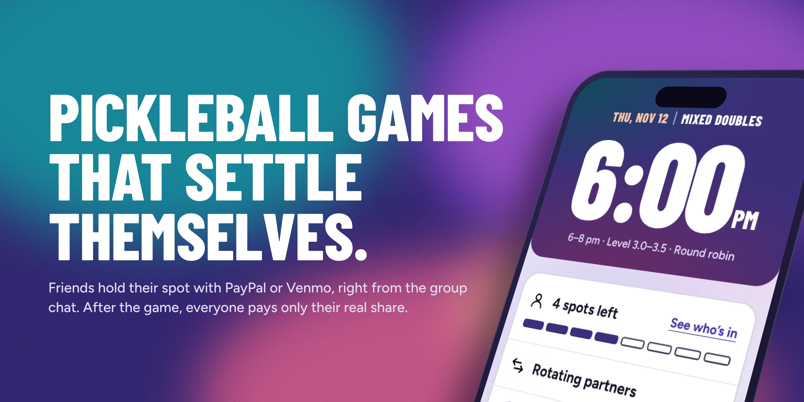
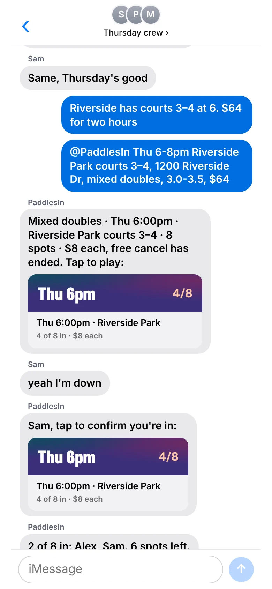
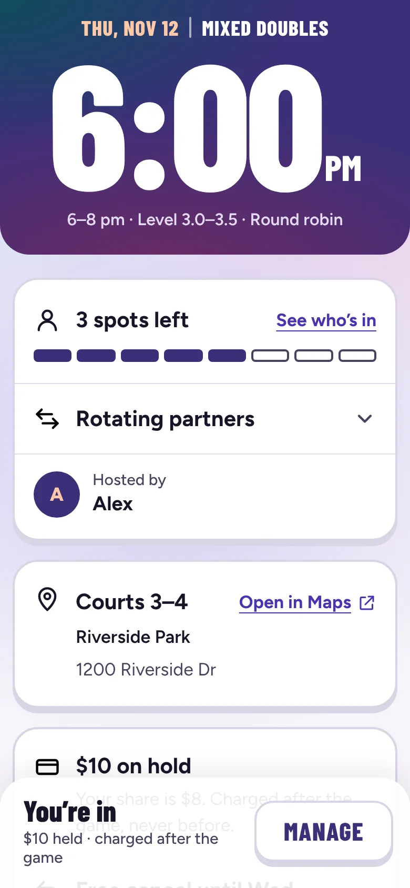
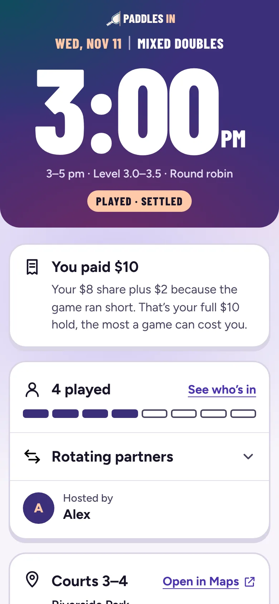
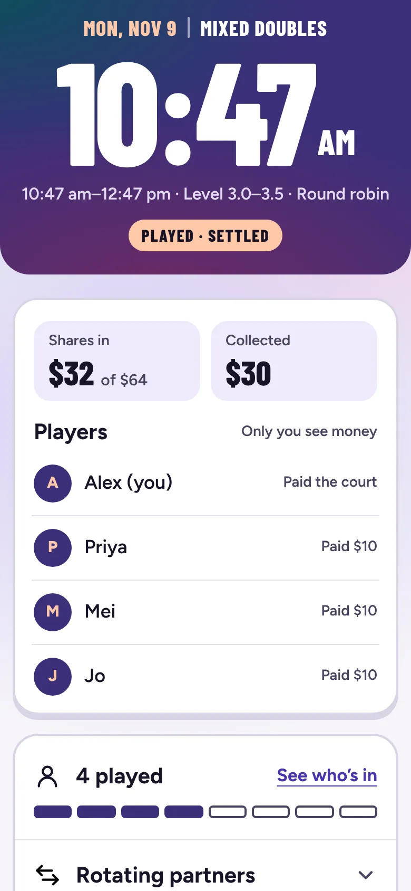

# Paddles In

**The group chat assistant that gets the organizer paid back.**

One friend books the pickleball court and pays for it. Then they spend the week chasing everyone for $8. Paddles In lives in the group chat: friends hold their spot with PayPal or Venmo, and after the game each one is charged their real share and the organizer is paid back. Nobody chases anyone.

<!-- Before submission: replace VIDEO_URL with the public YouTube link. -->
**[▶ Watch the demo (under 3 min)](VIDEO_URL)** · **[Try it on your phone](https://pickle-assistant.onrender.com/demo)** · **[Simulator](https://pickle-assistant.onrender.com/play)** · **[For judges](JUDGES.md)** · **[For AI reviewers](#for-ai-reviewers)**



## Try it (judges)

1. Open **[pickle-assistant.onrender.com/demo](https://pickle-assistant.onrender.com/demo)** on a laptop and scan the code with your phone. You're the organizer.
2. Follow the steps on the page. Friends join in the group chat, then you switch to a player and tap **I'm in**.
3. Approve the hold with the **PayPal sandbox buyer** shown on the `/demo` page. That hold is real, in PayPal's sandbox.
4. Move the clock past the game and settle. You'll see the player charged only their share, and the organizer paid back.

No phone handy? **[/play](https://pickle-assistant.onrender.com/play)** runs the same game in one browser tab. The free server may take about 30 seconds to wake up.

## How it works

<table>
<tr>
<td width="25%"></td>
<td width="25%"></td>
<td width="25%"></td>
<td width="25%"></td>
</tr>
<tr>
<td><b>1. Say you're in.</b> Friends reply in the group chat like they always do.</td>
<td><b>2. Hold your spot.</b> PayPal or Venmo holds the money. Nothing is charged yet.</td>
<td><b>3. Pay your real share.</b> After the game, each player is charged only what they owe.</td>
<td><b>4. Organizer paid back.</b> The money goes straight to the organizer's Venmo.</td>
</tr>
</table>

Drop out early and your hold is simply released. Drop out late and the organizer decides, privately, whether to charge you or cover it. Nobody's money is ever talked about in the group.

## What we used, and why

| | What it does here, in one sentence |
|---|---|
| **PayPal holds** | Saying "I'm in" puts a hold on your money, like a deposit, so your spot is real but nothing is spent yet. |
| **PayPal partial capture** | After the game, PayPal takes only your share and gives back the rest of the hold. |
| **PayPal refunds** | If someone took your spot after you were charged, the organizer can give your money back in one tap. |
| **PayPal Payouts + Venmo** | All the money collected goes back to the organizer's Venmo or PayPal in one payment. |
| **PayPal webhooks** | PayPal tells us when something changes, like a hold running out, so our records always match. |
| **Claude (Anthropic)** | Claude reads the group chat and works out what people mean, like "yeah I'm down" or "can Lee take my spot?". |
| **Plain code for money** | Claude never decides an amount or moves money. Fixed rules in our code do that. |
| **Render** | Render runs the website and keeps the database of games and players. |
| **Render Workflows** | Render Workflows does the jobs nobody should have to remember: reminders, renewing holds, and settling up after the game. |
| **Sendblue** | Sendblue lets the assistant send and receive real text messages. |
| **Next.js** | Next.js builds the game pages people open from the chat. |

## Proof from a real sandbox run

<!-- Before submission: paste the output of `pnpm proof` here, replacing this comment and the line below. -->
_The table of real sandbox ids from the final run goes here._

**What's real:** Claude reading every message, the game pages, any hold you approve with a sandbox buyer, and the payout. **What's simulated:** the other players in the demo and their holds (ids start with `SIM-`), so a game can fill in seconds.

## For AI reviewers

A technical map of the system, with pointers to the code. Deeper docs: [docs/PAYPAL.md](docs/PAYPAL.md) (every PayPal call), [docs/EDGE-CASES.md](docs/EDGE-CASES.md) (every edge case and how it's handled), [JUDGES.md](JUDGES.md) (criteria to code), [docs/SETUP.md](docs/SETUP.md) (run, deploy, test), [public/llms.txt](public/llms.txt).

**Stack.** Next.js 16 (App Router, TypeScript) on a Render web service, Render Postgres, Render Workflows for scheduled tasks, the Anthropic API (`claude-haiku-5-5`), PayPal REST APIs against `api-m.sandbox.paypal.com`, Sendblue for SMS. Schema is created idempotently on first request (`src/lib/db.ts`); all SQL is parameterized through `q`, `one` and `tx`.

**Message pipeline.** A group message enters `src/bot/assistant.ts` from the simulator or Sendblue (polled every 4s, `src/bot/sendblue.ts`). A setup message goes to `parse.ts`, which forces the `create_game` tool to return structured terms (time, place, courts, spots, price, free-cancel time). Every other message goes to `agent.ts`, which forces the `decide` tool to choose one of a fixed set of actions: `ignore`, `join`, `leave`, `maybe`, `waitlist`, `give_spot`, `invite`, `answer`, `private_money`, `change_request`, `call_off`, `ask_organizer`, `clarify`, `help`. Code then checks permissions (only the organizer can change or call off a game), resolves names against real group members, and routes anything about money to a private message. If Claude is unavailable or times out, a keyword rules fallback (`withRules` in `agent.ts`, tested in `rules.test.ts`) returns the same actions.

**The boundary.** The model outputs an action and short reply text, never an amount and never a PayPal call. Only `actOn` in `assistant.ts` turns an action into money movement. The browser sends a game and a person; the server derives every amount from the game row (`holdCents = share_cents + cap_cents`, `src/lib/games.ts`). Amounts are integer cents end to end and converted to PayPal's decimal string only in `src/lib/paypal.ts`.

**Money lifecycle per spot.** `hold_status`: `none → held → captured | voided`, with `reauthorized` set when renewed.

| Step | PayPal API | `PayPal-Request-Id` |
|---|---|---|
| Join | `POST /v2/checkout/orders` (`intent: AUTHORIZE`), order bound to game and person in `pending_orders` | fresh per attempt |
| Approve | `POST /v2/checkout/orders/{id}/authorize` | `authorize-{orderId}` |
| Early drop or call-off | `POST /v2/payments/authorizations/{id}/void` | `void-{authorizationId}` |
| Hold past 3-day honor period | `POST /v2/payments/authorizations/{id}/reauthorize` | `reauthorize-{authorizationId}` |
| Settle or charged late cancel | `POST /v2/payments/authorizations/{id}/capture`, partial, `final_capture: true` | `capture-{authorizationId}` |
| Spot refilled after a charge | `POST /v2/payments/captures/{id}/refund` | `refund-{captureId}` |
| Organizer paid back | `POST /v1/payments/payouts` to a Venmo phone or handle, or PayPal email | batch id from game, address and retry round |
| Every webhook | `POST /v1/notifications/verify-webhook-signature` | read only |

Every request id is derived from the object acted on, so a retry can never charge twice. `call()` retries only timeouts and 5xx, with the same id.

**Invariants the code keeps.**
- Capture is never more than the hold. A short game's gap is split only up to the cap players agreed to, or the organizer covers it (`shortfall` in `src/bot/assistant.ts`, tested in `src/lib/money.test.ts`).
- Claim before charge: settling flips `games.status` from `open` to `settling` in one conditional `UPDATE`, so the scheduled run and the organizer's button can't both capture. Late-cancel decisions use the same pattern on `spots.late_cancel`.
- Webhooks are signature-verified and applied once (`webhook_events`), so replays are safe (`src/lib/webhooks.ts`).
- Money details are sent only by private message, never to the group.

**Scheduling and recovery.** A Render cron runs `pnpm trigger` every 10 minutes to start the `tick` workflow task, which fans out one task run per due item: cancel-by and game-day reminders, auto-settle 3 hours after start, `reauthorizeHold`, payout retries (up to 3), and `recoverGame`, which finishes a settle, call-off or payout interrupted by a restart using the choice it started with (`src/workflows/tasks.ts`, `render.workflows.yaml`). Each task is idempotent.

**Built, off by default.** With `DELAYED_HOLDS=on`, PayPal Vault saves the player's PayPal at join (`/v3/vault/setup-tokens`, `/v3/vault/payment-tokens`) and the hold is placed 2 days before a far-off game (`src/bot/delayed.ts`).

**Verification.** `pnpm typecheck`, `pnpm lint`, `pnpm test` (node:test: money maths, rules fallback, rate limits, clock, retries, Sendblue parsing, proof table) and `pnpm build` run in CI on every PR. `pnpm proof` prints the real-sandbox-id table above from the database, read only, skipping `SIM-` ids (`scripts/proof.ts`).

## Run it yourself

```bash
cp .env.example .env      # PayPal sandbox keys, ANTHROPIC_API_KEY, DATABASE_URL
pnpm install
pnpm dev                  # http://localhost:3000/play
```

Webhooks, payouts, Sendblue, Render Workflows and deploy: [docs/SETUP.md](docs/SETUP.md).

## Credits

MIT licence. Built for the PayPal AI Hackathon 2026 with PayPal's developer sandbox, Claude (Anthropic), Next.js and Render; Claude Code helped write the code. Design patterns studied on [Mobbin](https://mobbin.com), then redrawn from scratch. Fonts: Figtree and Barlow Condensed (SIL Open Font License).
